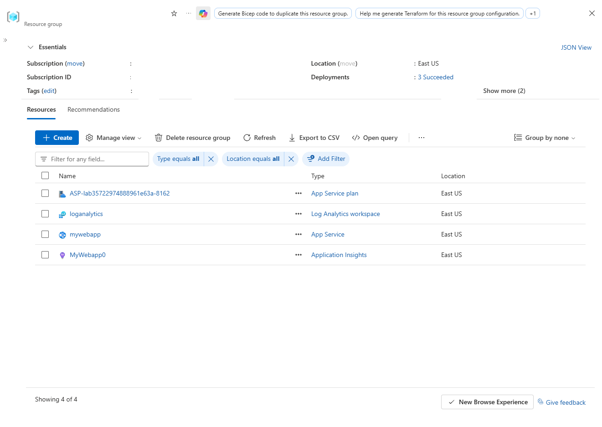
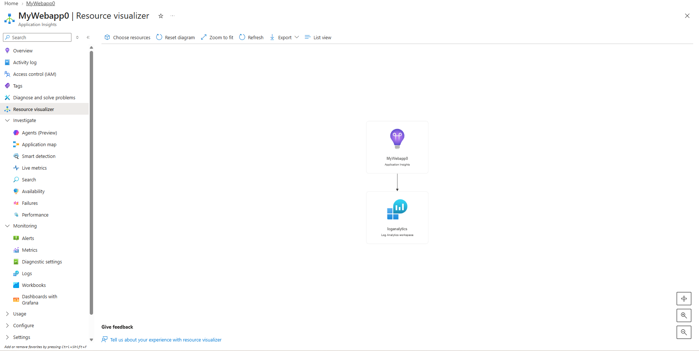
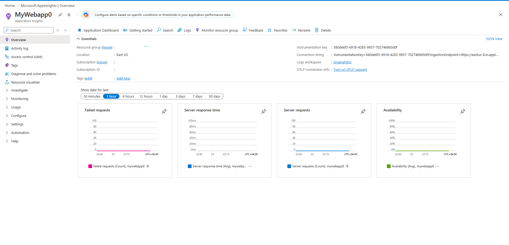
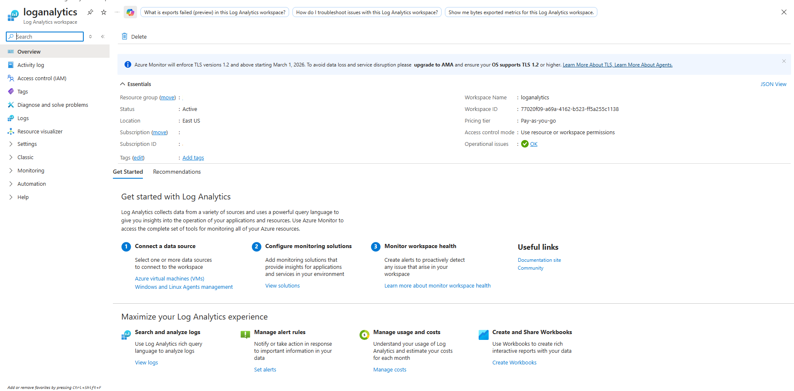
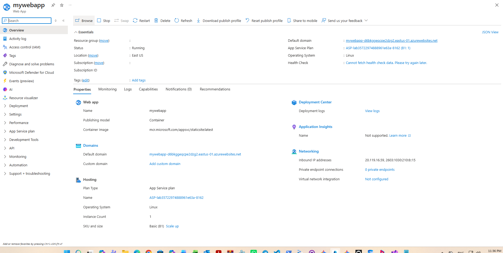
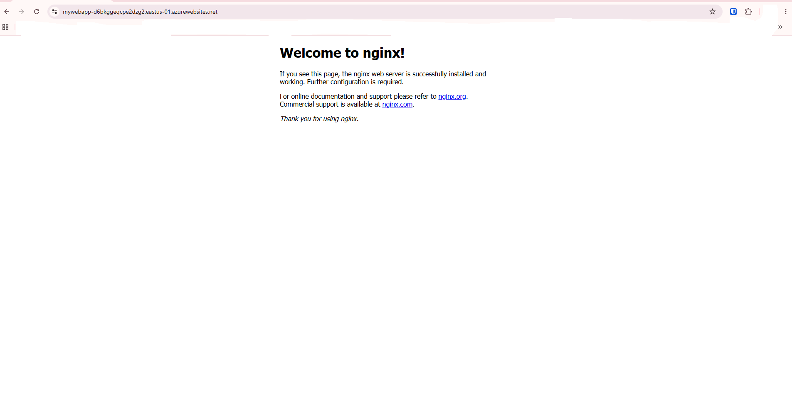

# Working with Application Insights

Comprehensive detailing the architecture, provisioning, and configuration of **Application Insights** integrated with **Azure App Service** and a **Log Analytics Workspace**. The deployment monitors web application telemetry, requests, response times, and failure rates.

---

## 1. Architecture & Provisioned Resources

### Core Infrastructure Topology

| Resource Type | Resource Name | Specification / Tier | Region / Location |
| :--- | :--- | :--- | :--- |
| **Application Insights** | `MyWebapp0` | Workspace-based, 90-Day Retention | East US |
| **Log Analytics Workspace** | `loganalytics` | PerGB2018 Pricing Tier, 30-Day Retention | East US |
| **App Service** | `mywebapp` | Basic Tier (`B1`), Linux OS | East US |
| **App Service Plan** | `ASP-lab35722...` | Basic (`B1`), 1 Instance | East US |

---

### Provisioned Environment Validation

*Resource group overview confirming successful deployment of the App Service plan, Log Analytics workspace, App Service web app, and Application Insights instance.*

*Resource visualizer showing the monitoring relationship between Application Insights and the Log Analytics workspace.*

---

## 2. Step-by-Step Implementation

### Step 1: Inspect Application Insights Overview

Inspected the provisioned Application Insights instance (`MyWebapp0`) to review essential configuration parameters, connection strings, instrumentation keys, and live telemetry charts for failed requests, server response times, server requests, and availability.

* **Instrumentation Key:** `380de6f3-6918-4283-9957-70274696500f`
* **Logs Workspace:** `loganalytics`

*Viewing telemetry metrics and connection properties for Application Insights.*

---

### Step 2: Review Log Analytics Workspace Configuration

Inspected the central Log Analytics workspace (`loganalytics`) used for ingesting telemetry logs, query analytics, and system metrics.

* **Workspace ID:** `77020f09-a69a-4162-b523-ff5a255c1138`
* **Pricing Tier:** Pay-as-you-go

*Inspecting workspace essentials, status, and management options in Log Analytics.*

---

### Step 3: Verify Azure App Service Deployment

Checked the configuration properties and runtime status of the target App Service web app (`mywebapp`) hosting the containerized application.

* **Default Domain:** `mywebapp-d6bkggeqcpe2dzg2.eastus-01.azurewebsites.net`
* **Runtime:** Linux Container (`mcr.microsoft.com/appsvc/staticsite:latest`)

*Reviewing App Service properties, domain settings, and deployment center details.*

---

### Step 4: Validate End-to-End Web Application Access

Accessed the default domain endpoint of the web app via a browser to ensure the containerized Nginx application is running and accessible.

* **Endpoint URL:** `https://mywebapp-d6bkggeqcpe2dzg2.eastus-01.azurewebsites.net`

*Browser validation displaying the default Nginx welcome page served through the App Service.*
